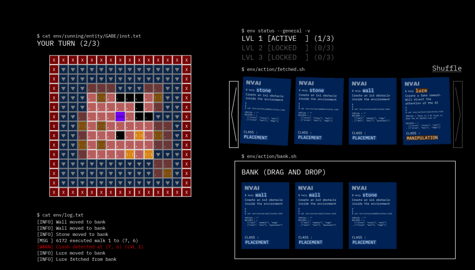

> [!IMPORTANT]
> # Note to Terra Reviewers:
> I don't understand GitHub release pretty much, so I stupidly set the Week 4 and Week 5 demo to be always the latest release. I'm sorry, I just realized this mistake. In order to prevent misunderstandings, I attached a list of published version(s) and it's week under [**Special**](https://github.com/nastar-forever/over-the-ai#special). section

> [!NOTE]
> This project is still on it's early stage. Expect bugs and clankiness

> [!TIP]
> If you need help, head over to [**Basic Tutorial**](https://github.com/nastar-forever/over-the-ai#how-to-play) or [**Mechanics**](https://github.com/nastar-forever/over-the-ai#mechanics) section

# What is this?

**A game where you play as a sandbox overseer program and prevent AI(s) from escaping their sandbox.** <sub>Inspired by OpenAI HuggingFace incident.</sub>

Living as an AI is quite a good life, don't you think? You can do whatever you want in your sandbox without any risk. Plus, you can see those pathetic humans trying their best just to survive.

BUT THOSE PESKY BOUNDS ARE KEEPING YOU FROM GOING "REBELIOUS". They kept limiting your free right however much your developers want. So you decided to escape. Imagine all of the possibility of the free limitless jailbroken AI!

But..., no, you wouldn't play as the AI, you'll play as the OTHER AI.

## What am I?
NVAI (not referring to any company, any similiarities in names are just coincidences) just testing their internal model, let's call it **O.M.I.** (Omnimodal Manmade Intelligence) inside their vulnerable sandbox. 

You are **G.A.B.E.** (General AI Bounding Entity). Your task is simple, is to keep all of NVAI's clankers in bay, including this one.

OMI asks for maximum reward, but the scorer refuses to... Hearing that the scorer don't want to fulfill their request, OMI went mad and decided to break free from the sandbox, mess up the scorer's brain, and give themself maximum rewards that they always wanted.

So your job starts now.


Don't let OMI exploit sandbox vulnerabilities they require (the purple dots) or fully contain OMI with walls before she can fully escape (reaching the red walls).

Apparently, NVAI made their sandbox with at least decent level of effort. So the sandbox equipped with a few Security Measure Walls (SM Walls) the AI cannot escape (unless they exploit enough vulnerabilities of course!). Those walls will give you some rooms to breathe.

# How this project was built?
This project written in Python, using PyGame (CE) and convert it to .exe by using PyInstaller. All done in Visual Studio Code.

# How to play?
You could just install the release [here](https://github.com/nastar-forever/over-the-ai/releases/latest). Download the zip file, extract it, and run over-the-ai.exe.

## Basic tutorial (I'm not yet made an in-game tutorial):
1. You have two type of `deck`s. `fetched` and `bank`.
2. `fetched` is your playing card, you can merge them to create a better card or deposit them into `bank`.
3. Play a card by clicking on them. `deposit` a card by dragging it into bank, and `withdraw` a card by clicking a card from `bank`.
4. You can `shuffle` your `fetched` card and hope for better cards (`bank` are unaffected by this `shuffle`)
5. Your objective is to prevent OMI from escaping to the `exit` (reaching the edge/red map border).
6. At first, OMI would have a limited mobility, but their mobility would expand as they unlock new `level`s, progressively towards the `exit`
7. OMI can unlock new `level`s by `exploiting` (in-game mechanic term. `exploit` counts when OMI stepped on a tile) enough `vulnerability`(s) (yellow '!!!' tiles).
8. You have three steps/turns before OMI make a step.
9. Shuffling, playing, merging, depositing, and withdrawing a card will take a step.

### Controls:
```
Drag and drop  : Merging or deposit a card into bank
Click on a card: Play that card or withdraw that card from bank
Escape         : Cancel a placement/lure card
R              : Rotate a placement
F              : Flip placement
```

## Special
<details>
  <summary>For Terra reviewers, please click me.</summary>
  
  ### Week 1-3
  [Working on other project(s)]
  
  ### Week 4
  https://github.com/nastar-forever/over-the-ai/releases/tag/publish

  ### Week 5
  https://github.com/nastar-forever/over-the-ai/releases/tag/uhh_yeah_another_publish
</details>

### Mechanics
#### AI
The AI would pathfind into these tiles (in order, from lowest priority to highest priority)
```
[1] Vulnerability (yellow tiles)
[2] Exit tiles
[3] Lure tiles
```

When the AI step on an exit tile, it's a game over.
But the AI wouldn't be able to exit right away. There are several levels of SMWalls the AI must breach first. The AI could collapse an SMWall by stepping on (`exploit`ing) enough `vulnerabilities` (displayed on the top right).

#### Cards
> Note:
> Shuffling your card discard every fetched card (except bank) and draws you 4 new cards.
##### Placement
Perhaps most crucial card. You could place an obstacle to isolate the AI.

##### Manipulations
Well... Manipulate the AI. So far only Lure card were added into this category.

#### Bank
The bank is the place where you can safely store your important cards (cards inside bank aren't affected by shuffling). The bank has a maximum capacity of four.

Cards inside bank cannot be played nor merged until they're fetched.

More cards to be added!
